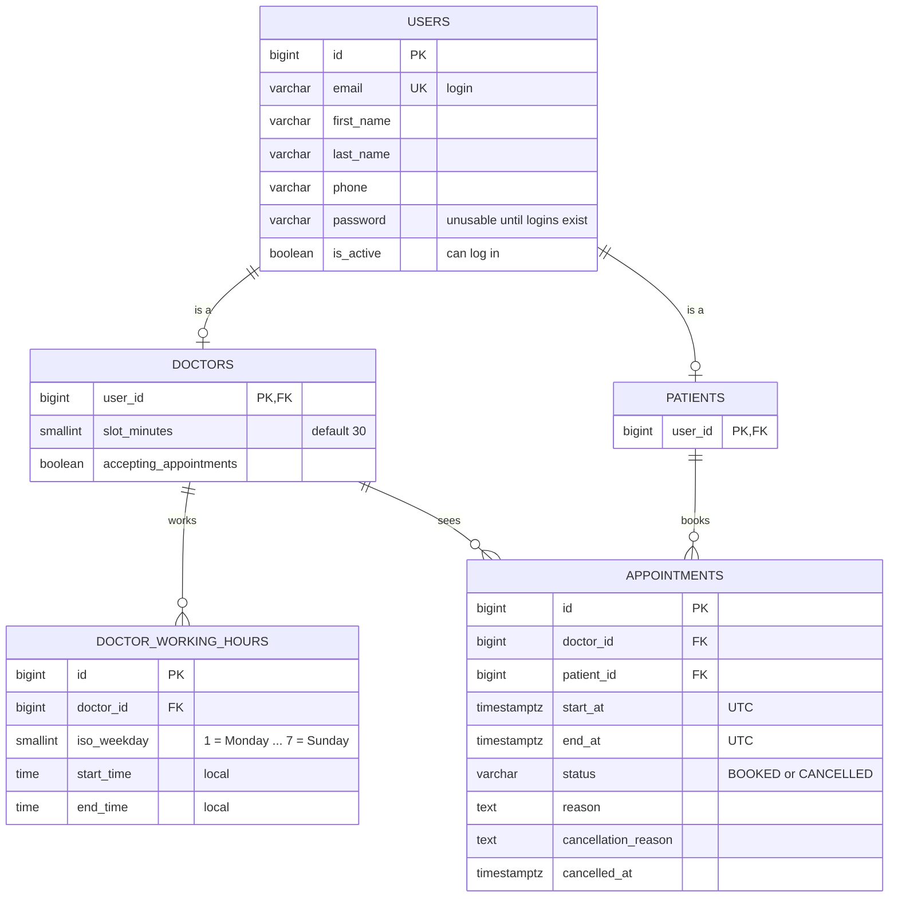

# small-clinic

A REST API for booking appointments at a small clinic with 5 doctors. Each doctor has set working hours split into fixed-length slots. Patients see a doctor's free slots for a day, book one, cancel it, or move it to another slot. Once a slot is booked, nobody else can take it.

Built with Django REST Framework on PostgreSQL.

## System design

### Summary

The booking system needs five tables: **users**, **doctors**, **patients**, **doctor_working_hours** and **appointments**. A person's identity (name, email, phone) lives once on the user; doctors and patients are one-to-one profiles holding only what their role needs. Doctor time off and an audit trail are left for later (see [Growth path](#growth-path)).

- **Database:** PostgreSQL with the `btree_gist` extension, chosen for exclusion constraints and `timestamptz`.
- **Slots are computed, not stored.** Availability = working hours stepped by the doctor's slot length (default 30 min), minus anything that overlaps an active appointment.
- **Clashes are detected by overlapping time ranges, not by matching start times.** An exclusion constraint rejects two non-cancelled appointments for the same doctor (or the same patient) whose times overlap. This holds for any slot length or break pattern, and under simultaneous requests.
- **Two layers of enforcement.** The application checks every business rule and returns clear errors. The database constraint is the final guard against races. Constraint errors are wrapped in domain errors that keep the original stack trace, and returned as 409.
- **Times are stored in UTC.** Working hours are stored as local clock times in the clinic's time zone (Africa/Nairobi, UTC+3).

### Entity-relationship diagram

Each person is one user. Doctors and patients are profiles of a user and never link directly; each appointment joins one of each. Working hours hang off doctors.

### Tables

`users`, `doctor_working_hours` and `appointments` have a `BIGINT` identity primary key `id`. `doctors` and `patients` use their `user_id` as primary key. Every table except `users` (which has Django's `date_joined`) also has `created_at` and `updated_at` (`TIMESTAMPTZ NOT NULL DEFAULT now()`). These columns are left out of the tables below.

#### users

The project's custom Django user model (`accounts.User`, table `accounts_user`), based on `AbstractUser` with `username` removed. Email is the login. Every doctor and patient has a user row; until logins exist, their password is unusable.

| Column | Type | Constraints | Notes |
| --- | --- | --- | --- |
| email | VARCHAR(254) | NOT NULL, UNIQUE | Login identifier (`USERNAME_FIELD`) and natural identity |
| first_name | VARCHAR(150) | NOT NULL | |
| last_name | VARCHAR(150) | NOT NULL | |
| phone | VARCHAR(20) | NULL | |
| password | VARCHAR(128) | NOT NULL | Unusable for doctors and patients until logins exist |
| is_active | BOOLEAN | NOT NULL, DEFAULT true | Can log in. Separate from whether a doctor takes bookings |

Django also adds `is_staff`, `is_superuser`, `last_login`, `date_joined` and the groups and permissions link tables. Users are deactivated, never deleted.

#### doctors

Profile for the 5 clinic doctors. Doctors are never deleted, so their old appointments stay valid; they stop taking bookings instead.

| Column | Type | Constraints | Notes |
| --- | --- | --- | --- |
| user_id | BIGINT | PRIMARY KEY, FK → users.id, ON DELETE RESTRICT | One-to-one with the user |
| slot_minutes | SMALLINT | NOT NULL, DEFAULT 30, CHECK slot_minutes > 0 | Length of each bookable slot. Changing it affects only slots not yet booked |
| accepting_appointments | BOOLEAN | NOT NULL, DEFAULT true | When false, the doctor shows no availability and cannot be booked |

#### patients

Profile for people who book appointments. It has no columns of its own yet: it marks a user as a patient, so `appointments.patient_id` can only point at a patient. Patient-only fields go here when they are needed.

| Column | Type | Constraints | Notes |
| --- | --- | --- | --- |
| user_id | BIGINT | PRIMARY KEY, FK → users.id, ON DELETE RESTRICT | One-to-one with the user |

#### doctor_working_hours

A doctor's weekly recurring hours. Each row is one continuous block on one weekday, starting and ending at any minute. Gaps between blocks are breaks: 08:00–10:15 and 10:30–13:00 give a 15-minute tea break. A weekday with no rows is a day off.

| Column | Type | Constraints | Notes |
| --- | --- | --- | --- |
| doctor_id | BIGINT | NOT NULL, FK → doctors.user_id, ON DELETE CASCADE | |
| iso_weekday | SMALLINT | NOT NULL, CHECK (iso_weekday BETWEEN 1 AND 7) | ISO: 1 = Monday … 7 = Sunday. Maps to a `Weekday` enum in code |
| start_time | TIME | NOT NULL | Local clinic time |
| end_time | TIME | NOT NULL, CHECK end_time > start_time | Local clinic time, exclusive |

Table constraints:

- `UNIQUE (doctor_id, iso_weekday, start_time)`
- The application rejects a block that overlaps another block for the same doctor and weekday.
- The database only stores and compares the number. The application owns its meaning: it always computes a date's weekday in Python (`Weekday(date.isoweekday())`) and filters on it.

#### appointments

One row per booking. Rows are never deleted. Cancelling changes the status, and rescheduling moves the times on the same row.

| Column | Type | Constraints | Notes |
| --- | --- | --- | --- |
| doctor_id | BIGINT | NOT NULL, FK → doctors.user_id, ON DELETE RESTRICT | |
| patient_id | BIGINT | NOT NULL, FK → patients.user_id, ON DELETE RESTRICT | |
| start_at | TIMESTAMPTZ | NOT NULL | Stored in UTC |
| end_at | TIMESTAMPTZ | NOT NULL, CHECK end_at > start_at | start_at + the doctor's slot_minutes at booking time |
| status | VARCHAR(20) | NOT NULL, DEFAULT 'BOOKED', CHECK IN ('BOOKED', 'CANCELLED') | |
| reason | TEXT | NULL | Patient's reason for the visit |
| cancellation_reason | TEXT | NULL | Optional |
| cancelled_at | TIMESTAMPTZ | NULL | |

Table constraints and indexes:

- `appointments_no_doctor_overlap`: `EXCLUDE USING gist (doctor_id WITH =, tstzrange(start_at, end_at) WITH &&) WHERE (status <> 'CANCELLED')`. A doctor cannot have two active appointments whose times overlap. This is the double-booking guard.
- `appointments_no_patient_overlap`: the same constraint on `patient_id`. A patient cannot be booked in two places at once.
- `CHECK ((status = 'CANCELLED') = (cancelled_at IS NOT NULL))`: a cancelled row always has a cancellation time, and a booked row never does. The reason is optional.
- `INDEX (patient_id, start_at)`: serves the patient's upcoming appointments in date order.

`tstzrange` is half-open (start included, end excluded), so back-to-back appointments such as 10:00–10:30 and 10:30–11:00 do not clash. The condition is `<> 'CANCELLED'` so that any status added later holds the slot unless it is deliberately excluded.

### Relationships

Users link one-to-one to the doctor and patient profiles; every other relationship is one-to-many. Doctors and patients meet only through `appointments`, which acts as the link table between them, so the schema has no direct many-to-many. One user can hold both profiles, for example a doctor who is also a patient.

| Parent | Child | Cardinality | Foreign key | On delete | Why |
| --- | --- | --- | --- | --- | --- |
| users | doctors | 1 → 0..1 | user_id (also the primary key) | RESTRICT | A doctor is a user; users are deactivated, never deleted |
| users | patients | 1 → 0..1 | user_id (also the primary key) | RESTRICT | Same, for patients |
| doctors | doctor_working_hours | 1 → 0..many | doctor_id | CASCADE | Hours have no meaning without their doctor |
| doctors | appointments | 1 → 0..many | doctor_id | RESTRICT | Appointment history must survive; the doctor stops taking bookings instead |
| patients | appointments | 1 → 0..many | patient_id | RESTRICT | Same reason, for patients |

Each appointment belongs to exactly one doctor and one patient.

### Key design decisions

#### 1. Slots are computed from working hours and slot length

There is no `slots` table. To get availability for a doctor on a date:

1. Load that doctor's `doctor_working_hours` rows whose `iso_weekday` matches the date, computed in Python.
2. Step through each block by the doctor's `slot_minutes`, starting at the block's start. A slot must end by the block's end; leftover minutes go unused (08:00–10:15 with 30-min slots ends at 09:30–10:00).
3. Drop any slot that overlaps a non-cancelled appointment. Two ranges overlap when each starts before the other ends.
4. Drop slots in the past, or less than 1 hour from now (bonus rule).

A booking is valid only if its start time matches one of these slots. A doctor has a few dozen slots a day at most, so computing them per request costs almost nothing.

#### 2. Clashes are found by overlap and enforced in two layers

- **Application:** the booking logic runs every check first and raises domain errors with clear messages (422 for invalid input, 409 for a taken slot). This handles the normal case.
- **Database:** the exclusion constraints reject any overlap between active appointments for the same doctor or the same patient. They catch the rare case where two requests pass the application check at the same moment. No row locks or retry logic are needed.

#### 3. Changing slot length or adding breaks needs no migration

- **New slot length:** update `doctors.slot_minutes`. Existing bookings keep their own start and end and stay protected; new slots skip anything they overlap.
- **Recurring breaks:** leave a gap between working-hours blocks, at any minute (for example 10:15–10:30).

#### 4. Error handling keeps the stack trace

A constraint violation (SQLSTATE `23P01`) is caught at the database boundary and re-raised as a domain error with the original chained: `raise SlotUnavailableError(...) from exc`. The APM tool records the full chain, and one global handler maps the domain error to 409. Clients never get a raw 500 for a taken slot, and the constraint name tells a doctor clash from a patient clash.

#### 5. Time handling

- Appointment times are `TIMESTAMPTZ`, stored in UTC.
- Working hours are plain `TIME` values in the clinic's local time zone, held in one setting: `CLINIC_TIMEZONE = Africa/Nairobi` (UTC+3, no daylight saving).
- "Availability on 2026-10-20" means 00:00 to 24:00 Nairobi time. The query converts that day to a UTC range.

#### 6. Reschedule updates the same row

`PATCH /appointments/{id}/reschedule` changes `start_at` and `end_at`, and optionally `doctor_id`, on the existing row in one transaction. The appointment keeps its id. The old slot is freed automatically because the row no longer covers it. The new slot gets the same checks as a new booking, against the new doctor's working hours and slot length when the doctor changes. The exclusion constraints guard it the same way. The previous time and doctor are not kept; an audit table can add that later.

#### 7. Status lifecycle

An appointment is `BOOKED` when created. It can go to `CANCELLED` once, and `CANCELLED` is final. Cancelling or rescheduling a cancelled appointment returns **409 Conflict**. Rescheduling keeps the status as `BOOKED`.

#### 8. People are users with role profiles

- **Identity lives once, on the user.** Name, email and phone are stored on `accounts.User`. `doctors` and `patients` hold only role-specific data, keyed by `user_id`.
- **Email is the login.** The custom user model removes `username` and sets `email` as `USERNAME_FIELD`, with a small custom manager for creating users.
- **No logins yet.** Doctors and patients are created with an unusable password. Creating a patient creates its user in the same transaction.
- **Two separate flags.** `users.is_active` controls whether someone can log in. `doctors.accepting_appointments` controls whether a doctor can be booked.
- **Profiles guarantee roles.** `appointments.doctor_id` points at `doctors`, so the database guarantees it is a doctor; the same holds for patients.

#### 9. Staff use the Django admin; patients register through the API

- **Doctors and working hours** are managed by staff in the Django admin at `/admin/`, behind a staff login. Working-hours blocks that overlap on the same weekday are rejected. Changing hours never touches existing bookings.
- **Appointments are view-only in the admin.** Every change goes through the API so the booking rules always apply.
- **Patients register themselves** with `POST /patients`, which creates the user (without a usable password) and the patient profile in one transaction. An email already used by any user returns 409.

#### 10. Where each rule is enforced

| Rule | Enforced by | Why there |
| --- | --- | --- |
| No overlapping bookings for a doctor | Application pre-check + database exclusion constraint | Must hold even under simultaneous requests |
| Patient not in two places at once | Application pre-check + database exclusion constraint | Same |
| An appointment's doctor is a doctor and its patient is a patient | Database (foreign keys to the profile tables) | Free with the profile design |
| Cancelled rows carry a cancellation time | Database (CHECK) | Cheap, keeps data consistent |
| Doctor is accepting appointments | Application | A booking rule, not a data shape |
| Slot inside working hours | Application | Needs a lookup in another table, which a CHECK cannot do |
| A doctor's working-hours blocks do not overlap | Application (admin form validation) | Spans several rows of the same doctor |
| Start time matches a generated slot | Application | Depends on the doctor's current slot length |
| Not in the past, at least 1 hour ahead | Application | Depends on the current time, which changes |

### Trade-offs considered

Each choice favours a stable system: the guarantees keep holding as slot lengths, breaks and statuses change, without a migration.

| Question | Chosen | Alternatives | Why the chosen option |
| --- | --- | --- | --- |
| How to stop double-booking? | Exclusion constraint on overlapping time ranges | Partial unique index on `(doctor_id, start_at)`; a nullable "active start" column with a plain unique constraint; application row locks only | A unique index catches only identical start times, so it breaks once slot lengths change or breaks fall off the 30-min grid. Moving to the exclusion constraint later would mean a full table lock and rewriting the overlap logic. The nullable column stores the start time twice. Row locks rely on every write path remembering them. |
| Database guard or application only? | Both: application for clear messages, database for races | Application only, with `SELECT … FOR UPDATE` on the doctor row | One forgotten lock silently allows double-bookings. The constraint fails safe. |
| How to surface constraint errors? | Wrap in a domain error with `from exc`, map to 409 | Let the raw database error bubble up | A raw error is a 500 to the client, which breaks the brief, and it fills the APM tool with expected conflicts. Chaining keeps the full trace. |
| Where do names and emails live? | On a custom user model, with doctor and patient profiles | Name and email columns on each of `doctors` and `patients`; one users table with a role column; Django multi-table inheritance | Identity is stored once and patient logins later need no data migration. A single table with a role column cannot guarantee `appointments.doctor_id` points at a doctor. Multi-table inheritance hides the join and makes one person holding both roles awkward. |
| Login identifier | Email (`USERNAME_FIELD`), `username` removed | Keep Django's `username` and copy the email into it | One identifier, no duplicated value to keep in sync. Costs a small custom user manager. |
| Store slots or compute them? | Compute from working hours | A pre-generated `slots` table with an `is_booked` flag | A slots table needs a job to create future rows and goes stale when hours or slot lengths change. |
| Slot length | Per doctor (`slot_minutes`) | One app-wide setting; per working-hours block | Covers the brief and the expected change. A per-block length can be added later. |
| Reschedule: same row or a new one? | Update the same row | Cancel the old row and insert a new one linked by `rescheduled_from_id` | The id stays stable for the patient and matches `PATCH /appointments/{id}/reschedule`. Change history can come later from an audit table. |
| Cancel: delete or soft-cancel? | Status change to `CANCELLED` | Delete the row | Keeps the cancelled booking and its reason, which reporting needs. |
| Status column type | `VARCHAR` + `CHECK` | A native Postgres `ENUM` type | Easier to change in migrations. |
| Weekday encoding | ISO numbers 1–7 mapped to a `Weekday` enum, computed in Python | 0–6; day names stored as text | Matches Python `isoweekday()` and Postgres `ISODOW` with no conversion. |
| Primary keys | `BIGINT` identity | UUID | Smaller and simpler. UUIDs would hide record counts in URLs, which matters more once auth and public exposure arrive. |
| Database | PostgreSQL | MySQL | MySQL has no exclusion constraints, so overlap prevention would fall back to application locks. |
| Test database | Real PostgreSQL (Docker) | SQLite | SQLite has no exclusion constraints, so tests on it would silently skip the guard. |

### Indexes by endpoint

Each of the two exclusion constraints builds a GiST index, which also serves overlap lookups. Two ordinary indexes cover the rest. Queries for active bookings must include `status <> 'CANCELLED'`; otherwise Postgres cannot use the conditional GiST indexes.

| Endpoint | What it reads or writes | Index used |
| --- | --- | --- |
| `GET /doctors/{id}/availability?date=` | Working hours for the doctor and weekday; active appointments overlapping that day's UTC range | `UNIQUE (doctor_id, iso_weekday, start_time)` on working hours; the doctor exclusion constraint's GiST index |
| `POST /appointments` | Check the slot, then insert the appointment | Both exclusion constraints (pre-check and final guard) |
| `PATCH /appointments/{id}/cancel` | Load by id, set status, time and optional reason | Primary key |
| `PATCH /appointments/{id}/reschedule` | Load by id, check the new slot (possibly with another doctor), update doctor and times | Primary key; both exclusion constraints |
| `POST /patients` | Insert the user and the patient profile in one transaction | `UNIQUE (email)` on users; a duplicate returns 409 |
| `GET /patients/{id}/appointments` (bonus) | Active rows for the patient with `start_at >= now()`, ordered by `start_at` | `(patient_id, start_at)`: already in date order, so no sort is needed. A GiST index does not return rows in order. |

### Growth path

Slot-length changes and recurring breaks already work without a schema change. Each item below adds a table or a column; none changes the double-booking guard. The first two are the most likely next steps.

| Need | Change |
| --- | --- |
| Doctor time off: leave, holidays, one-off breaks | New `doctor_time_off` table (doctor_id, starts_at, ends_at, reason), indexed on `(doctor_id, starts_at)`. Availability drops any slot that overlaps a row |
| Audit history of bookings, cancellations and reschedules | New `appointment_events` table (appointment_id, event_type, previous_start_at, new_start_at, note, created_at), written in the same transaction as each change |
| More than one clinic branch | New `clinics` table (name, timezone); add `doctors.clinic_id`; move the time zone from settings into this table |
| Visit types with different lengths | New `appointment_types` table with its own duration. The exclusion constraint already handles mixed lengths |
| Patient and doctor logins | No schema change: set a usable password on the existing user and add login endpoints. Endpoints then check the caller owns the appointment |
| Mark visits as attended or missed | Add `COMPLETED` and `NO_SHOW` to the status CHECK. They hold the slot by default |
| Planned changes to a doctor's hours | Add `effective_from` / `effective_to` dates to `doctor_working_hours` |

### Open questions

- [x] Must a patient already exist before booking? Yes: patients register with `POST /patients` and book with the returned id.
- [ ] What happens to existing bookings that fall outside a doctor's new working hours? Proposed: keep them and flag them for staff, never cancel them automatically.
- [ ] May a patient hold more than one upcoming appointment with the same doctor?
- [ ] Does the production database host allow the `btree_gist` extension? (Standard on major managed Postgres services; confirm once at setup.)
